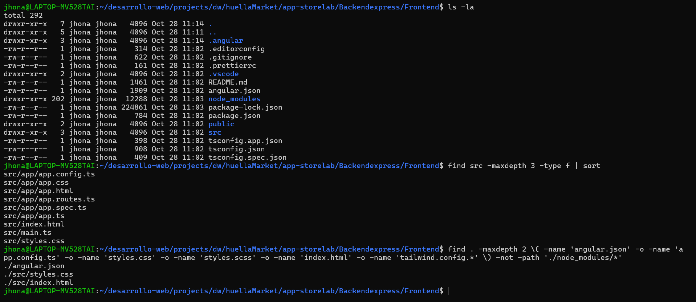

# HuellaMarket — Frontend

## ISS-01-E01-estructura-inicial

#### ISS-01-E02-instalacion-primeng

#### ISS-01-E03-instalacion-tailwind

#### ISS-01-E04-estilos-globales

#### ISS-01-E05-build

### 1.4.1 Licencia de PrimeNG 22 (obligatoria para la entrega limpia)

#### 1.5 Pantalla de arranque: `App` compone el componente `demo/ejemplo`

 

#### 1.6 Personalizar `index.html`

