# HuellaMarket — Frontend

## ISS-01-E01-estructura-inicial

## 1.7 Ajustar el presupuesto de build

#### ISS-01-E02-instalacion-primeng

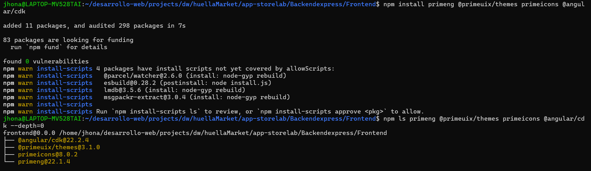

#### ISS-01-E03-instalacion-tailwind

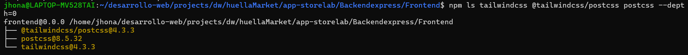

#### ISS-01-E04-estilos-globales

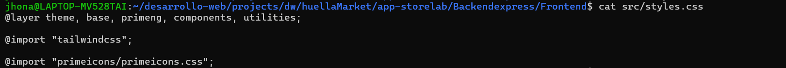

#### ISS-01-E05-build

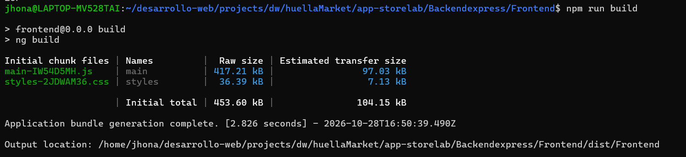

### 1.4.1 Licencia de PrimeNG 22 (obligatoria para la entrega limpia)

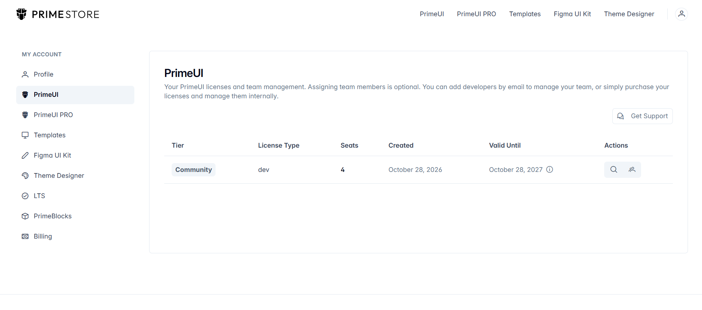

#### 1.5 Pantalla de arranque: `App` compone el componente `demo/ejemplo`

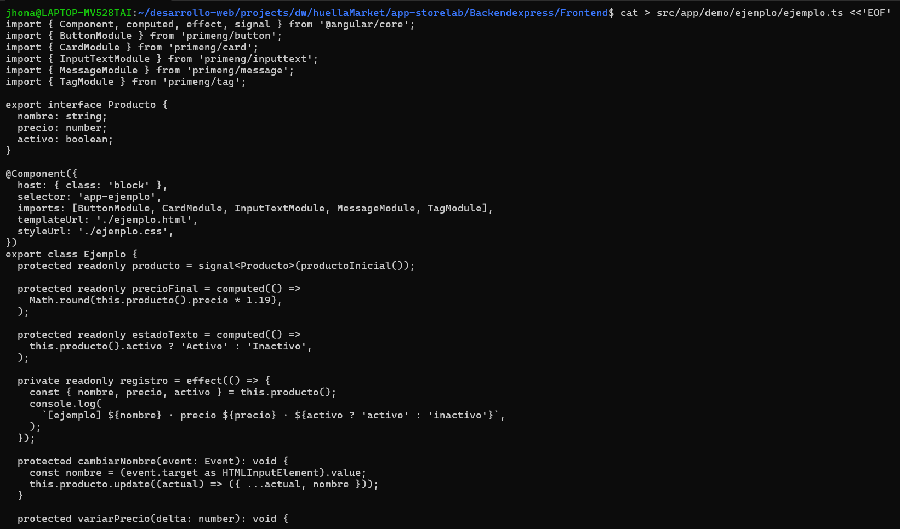 

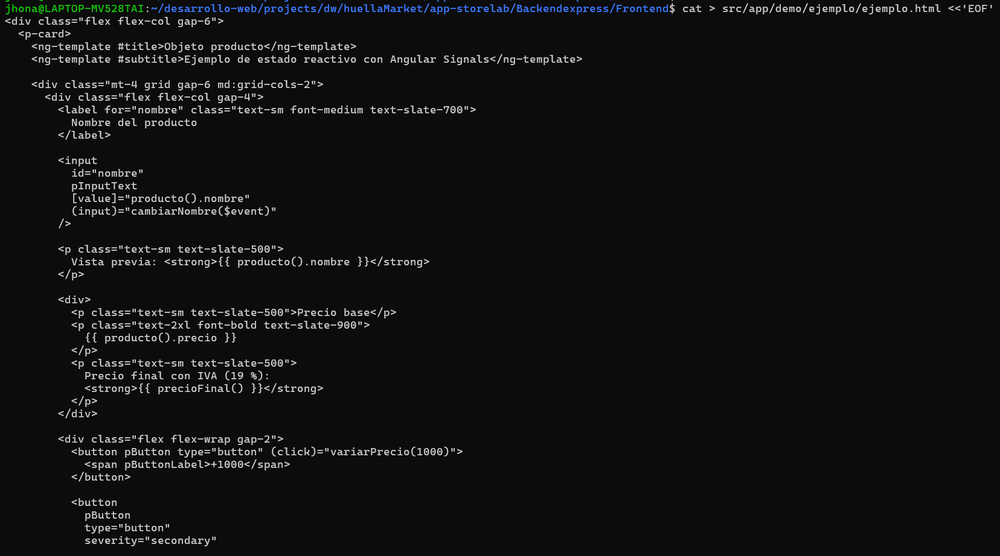

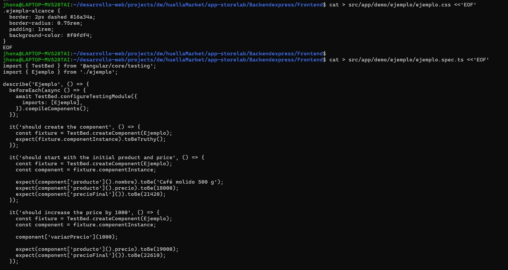

#### 1.6 Personalizar `index.html`

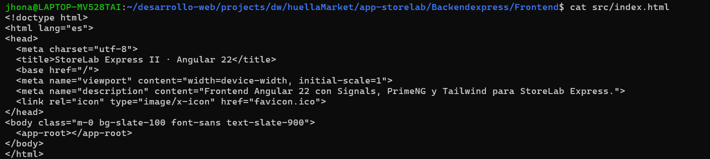

#### 1.7 Ajustar el presupuesto de build

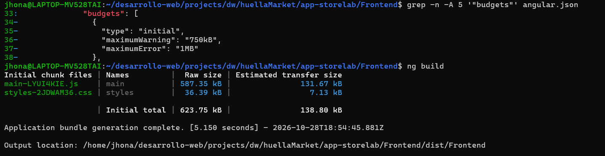

#### 1.8 Primera ejecución

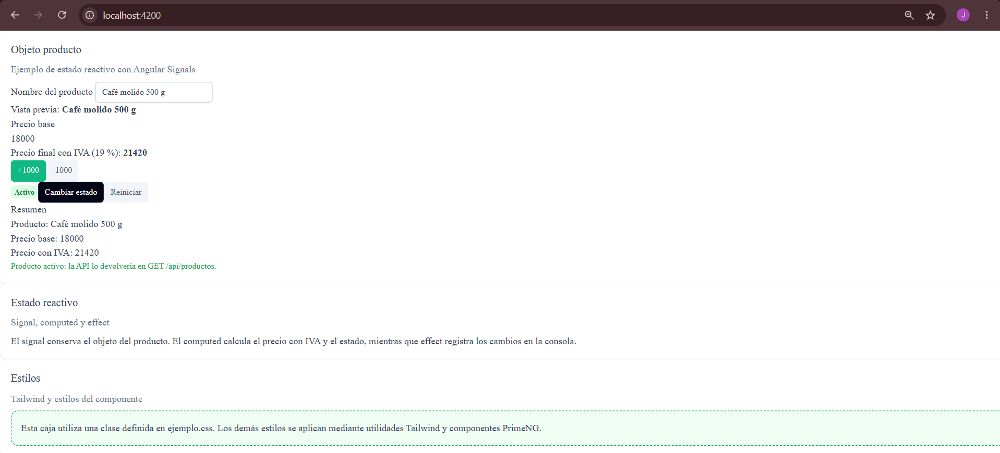

#### 1.9 Anatomía del componente `demo/ejemplo` y signals

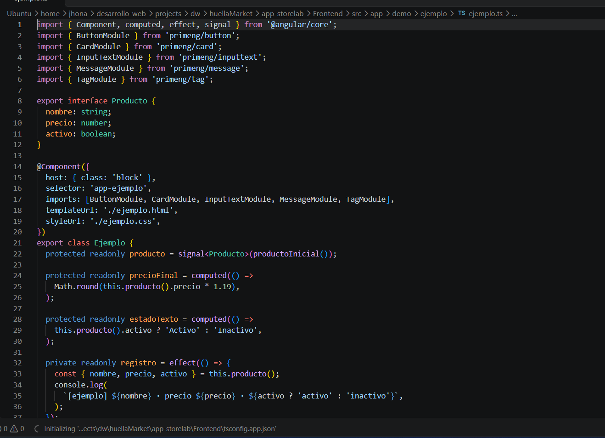

#### 1.9.1 De `index.html` a la pantalla - 1.9.2 Los cuatro archivos de un componente

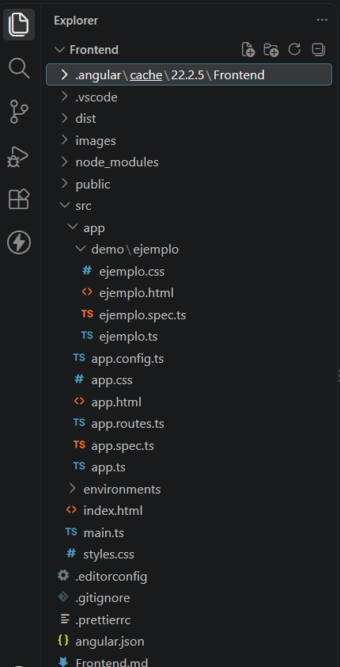

#### 1.9.3 Leer `ejemplo.ts` línea a línea

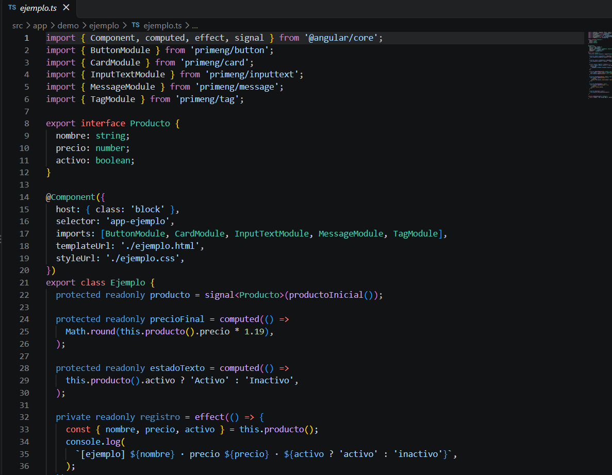
